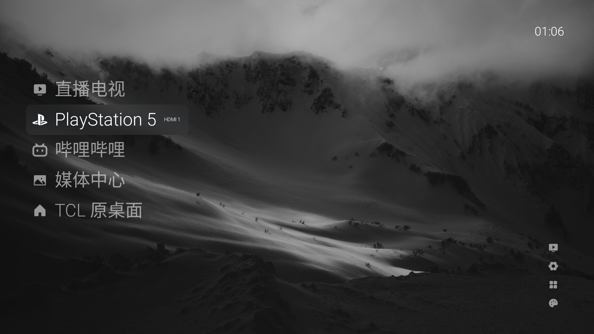

# Plain TV · TCL Edition

给 TCL `tcl_mt5879_cn`（Android 11，MT5879，1920×1080）定制的极简电视桌面。基于 [归藏电视 / GuiZang TV](https://github.com/op7418/guizang-tv) 的公开源码改造，但已经不再兼容上游的小米逻辑，也不合并上游更新。



## 当前状态

- 原生 Canvas 渲染，大字列表、壁纸轮播、毛玻璃焦点。
- 首页图标＋文字，默认毛玻璃选中；右侧操作默认只显示图标，聚焦时显示文字。
- 首页入口：直播电视、PlayStation 5（HDMI1）、哔哩哔哩、媒体中心、TCL 原桌面。
- 右下角：信号源、系统设置、全部应用、桌面设置。
- 设置页为扁平原生列表，无操作提示文案；右侧预览已移除。
- **无 Codex、无小米专用逻辑、无无障碍守护。**

## TCL 接入点

| 功能 | 实现 |
| --- | --- |
| TCL 设置面板 | `com.tcl.settings/.ShowWindowService` + `com.tcl.settings.SHOW_WINDOW` |
| 信号源面板 | 同一 service + `com.tcl.insrc.SHOW_WINDOW` |
| HDMI 直切 | `com.tcl.tv/.TVActivity` + `targetSourceId`（HDMI1=8，HDMI2=9，HDMI3=10，HDMI4=11） |
| TCL 原桌面 | `com.tcl.cyberui/.MainActivity` |
| 直播电视 | `com.tcl.tv/.TVActivity` |

设置和信号源都由 TCL 自己绘制，Plain TV 只负责触发，不修改 TCL 设置应用或数据。

## 构建

要求：**JDK 17、Gradle 8.7+、Android SDK Platform 34、Build Tools 34.0.0**。

```powershell
cd plain-tv
$env:JAVA_HOME = "<jdk-17>"
$env:ANDROID_HOME = "<android-sdk>"
gradle :app:assembleDebug
```

产物：`app/build/outputs/apk/debug/app-debug.apk`。

## 安装

当前版本**没有声明 HOME**，只作为普通电视应用安装，不会抢默认桌面。

TCL 的系统校验会拦截带 HOME 的第三方 APK，也会拦截普通 `adb install`。在 85Q10K 上可用的方式：

1. `adb push app-debug.apk /sdcard/Download/plain-tv.apk`
2. 在电视上打开文件，选择 APK 安装工具
3. 允许未知来源并安装

安装后从应用列表打开 **Plain TV**；按 Home 仍然回 TCL 原桌面。

## 限制

- 尚未接管默认 Home / 开机自启；TCL 的 ConfigProvider 安装校验路线尚未启用。
- TCL 设置/信号源是系统浮层，布局由 TCL 决定；不同固件可能行为不同。
- 首页内容名称编辑使用应用内弹窗；后续会继续完善磨砂玻璃样式。
- 仅在一台 TCL 85Q10K（`tcl_mt5879_cn`，build `RQ3A.210705.001`）上验证。

## 许可与来源

- 代码：MIT，见 [LICENSE](LICENSE)。
- 上游：https://github.com/op7418/guizang-tv
- 图标：Phosphor Icons（Regular / Fill），许可见 `app/src/main/assets/icons/`。
- 内置壁纸：Unsplash License，来源见 [docs/WALLPAPERS.md](docs/WALLPAPERS.md)。
